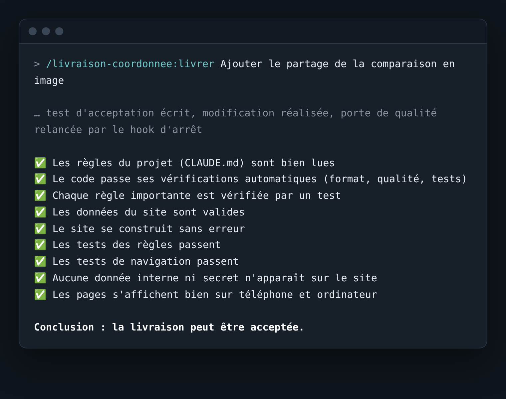

# livraison-coordonnee

_[English version](README.en.md)_

**Une commande, une livraison vérifiée.** Plugin Claude Code : il lit les règles de votre `CLAUDE.md`, écrit d'abord le test de la demande, réalise la modification, puis passe une porte de qualité (format, lint, types, données, construction, tests, navigation, affichage sur six largeurs). Un hook d'arrêt relance la porte avant toute conclusion : « terminé » n'est jamais annoncé sur un échec.



```bash
git clone https://github.com/Tuzilucas/livraison-coordonnee ~/outils/livraison-coordonnee
cd /chemin/vers/mon-projet && claude --plugin-dir ~/outils/livraison-coordonnee
```

Puis, dans Claude Code : `/livraison-coordonnee:livrer <votre demande>`. Notice pas à pas : [`NOTICE.md`](NOTICE.md). Contribuer : [`CONTRIBUTING.md`](CONTRIBUTING.md). Licence MIT. Version 1.6.0.

Validé en conditions réelles sur deux projets : une application web en un seul fichier (37 règles sur 37 contrôlées par un test) et un site Next.js de 900 pages (porte 9/9, fusion et publication). Le moteur a sa propre suite de 28 tests (`npm test`).

## Utilisation

    /livraison-coordonnee:livrer <description de la demande>

Sans description, la commande ne lance aucun travail et demande ce qu'il faut produire.

Installation :

    # 1. Dossier local (sûr, sans réseau)
    git clone https://github.com/Tuzilucas/livraison-coordonnee ~/outils/livraison-coordonnee
    claude --plugin-dir ~/outils/livraison-coordonnee

    # 2. Place de marché Claude Code (dans Claude Code)
    /plugin marketplace add Tuzilucas/livraison-coordonnee
    /plugin install livraison-coordonnee@tuzilucas

## Fonctionnement

1. **Cadrer** : lecture de `CLAUDE.md`, règles classées dans `.claude/regles-livraison.json`, choix mineurs notés dans `CHOIX.txt`.
2. **Prouver** : un test d'acceptation étiqueté `demande:<nom>` est écrit avant la modification.
3. **Produire** la modification.
4. **Porte de qualité** (`scripts/gate.mjs`), entièrement mécanique : vérifications du projet, couverture des règles par des tests, données, construction, tests des règles, navigation de bout en bout, interdits, affichage à 320, 360, 390, 768, 1024 et 1440 px (thème sombre s'il est déclaré). Rapport, résumé en français et captures dans `rapport-livraison/`.
5. **Corriger** tout échec et relancer, cinq essais au maximum.
6. **Verdict** : le hook d'arrêt (`scripts/verdict-arret.mjs`) relance la porte avant toute conclusion ; en cas d'échec, Claude est renvoyé au travail ; après épuisement des essais, la livraison est consignée « non terminée ». Journal dans `.livraison-journal.log`, reprise après coupure via `.livraison-etat.json`.

Chaque contrôle a un statut : `reussi`, `echoue`, `sans_objet` (le projet n'a pas cette étape ; ne compte ni pour ni contre) ou `non_execute` (étape attendue qui n'a pas tourné ; compte comme un échec). Un projet sans aucun mécanisme de vérification n'obtient jamais de porte verte.

## Langues

Le code, les noms de contrôles et le rapport technique sont en français. Les résumés (`RESUME.txt`) et les messages du hook existent en **français, anglais, espagnol, allemand et italien**. **La commande `livrer` détecte la langue de la demande** (`scripts/langue-demande.mjs`) et l'enregistre pour le projet : résumé, messages du hook, choix et rendu final suivent cette langue. Sinon : variable `LIVRAISON_LANGUE`, puis `"langue"` dans `.claude/regles-livraison.json` (`regles.mjs --langue=xx`), puis français. `/livraison-coordonnee:deliver` force l'anglais.

## Fichier de règles d'un projet

`.claude/regles-livraison.json`, généré par `scripts/regles.mjs` puis complété à la main :

- `sections_claude_md` : sections de `CLAUDE.md` que le fichier couvre (obligatoire) ;
- `routes` : pages à contrôler (sinon détection automatique, deux niveaux de dossiers) ;
- `largeurs` : largeurs d'écran (par défaut 320 à 1440 px) ;
- `interdits` : motifs qui ne doivent apparaître dans aucun fichier construit ;
- `controles`, `revue_humaine` : mots-clés qui classent une règle ;
- `interface_web: false` : projet sans pages (contrôles d'affichage sans objet).

## Avantages

- **Détecte de vrais défauts** : superpositions de texte, cibles tactiles trop petites, débordements, plantage de construction après une fusion, que la relecture seule n'avait pas vus.
- **Refuse sans négocier** : un contrôle en échec bloque la livraison ; un rapport absent, un plantage ou une valeur d'environnement ne peuvent pas la transformer en succès.
- **Traçable** : chaque passage laisse un rapport, un résumé en français, des journaux et des captures.
- **Reproductible** : les mêmes contrôles tournent à chaque passage, et le moteur est lui-même testé.

## Inconvénients

- **Plus lent** : une livraison prend 15 à 40 minutes, construction et tests compris, et consomme plus de jetons.
- **Ne juge pas le goût** : le design, le ton et la pertinence des textes ne sont pas mesurés.
- **Ne vérifie pas la compréhension des règles** : la porte contrôle qu'un test couvre chaque règle, pas que la règle est bien appliquée partout.
- **Dépend de l'environnement** : les contrôles d'affichage demandent Playwright et Chromium.
- **Faux positifs possibles** : plusieurs ont été corrigés (contenu replié, texte pour lecteurs d'écran, animations, icône d'onglet absente). D'autres peuvent apparaître sur des sites différents.

## Quand l'utiliser

**Oui**, quand la fiabilité compte plus que la vitesse : un site ou une application publique, une livraison qui doit respecter des règles écrites, un livrable difficile à corriger après publication.

**Non**, pour un prototype, une modification mineure, ou un projet sans tests ni construction : la porte ne pourrait rien prouver, et elle le dira.

## Limites connues

- Les tests écrits par le plugin doivent être relus au début : un test trop faible donne un faux vert.
- Les pages sont détectées jusqu'à deux niveaux de dossiers ; au-delà, les lister dans `routes`.
- Le contraste n'est mesuré que sur fond de couleur unie ; les textes sur image sont comptés « non mesurables », jamais validés.
- L'installation par la place de marché Claude Code suit le format documenté mais n'a pas encore été essayée sur un poste.

## Versions

- 1.6.0 : la commande `livrer` détecte la langue de la demande et s'exécute dans cette langue ; résumés et messages en cinq langues (fr, en, es, de, it ; `LIVRAISON_LANGUE`, `--langue=xx`, `langue` du fichier de règles) ; commande anglaise `/livraison-coordonnee:deliver`. Hook d'arrêt aligné sur la documentation Claude Code : lecture de `stop_hook_active`, abandon anticipé quand les mêmes échecs reviennent trois fois de suite pendant une continuation (plafond Claude Code de huit continuations consécutives sans appel d'outil, `CLAUDE_CODE_STOP_HOOK_BLOCK_CAP`), marqueur au format JSON (tentatives, sans progrès, empreinte des échecs ; ancien format numérique accepté). 39 tests.
- 1.5.0 : audit technique. Serveur de contrôle confiné au dossier construit (chemins résolus réellement, liens symboliques et encodages refusés), interface locale et port libre choisi par le système. Statuts explicites des contrôles : « reussi », « echoue », « sans_objet » (ne compte pas dans la fiabilité) et « non_execute » (compte comme un échec) ; un projet sans aucun mécanisme de vérification n'obtient jamais de porte verte ; pendant une livraison, le test d'acceptation doit être exécuté par un script (`test:regles`, `check` ou `test`), pas seulement présent ; `interface_web: false` déclare un projet sans pages. Lecture sûre des JSON (règles, `package.json`), motifs interdits invalides diagnostiqués, plantage interne de la porte converti en rapport d'échec. Verrou contre deux portes simultanées. Navigateur toujours fermé, même sur exception. Mode rapide : le build est refait si une dépendance, un lockfile, une configuration ou un `.env` a changé. Hook d'arrêt : `LIVRAISON_ESSAIS` borné (1 à 50), marqueur illisible toléré, rapport absent ou malformé traité comme un échec, abandon après épuisement consigné dans `.livraison-etat.json` (`terminee: false`) et signalé par un message système. Faux positifs corrigés : icône d'onglet absente, dossier de tests non suivi par Git. Suite de tests du moteur sur projets temporaires (`npm test`, 28 tests).
- 1.4.1 : contrôle d'affichage : un résumé imbriqué dans un bloc replié n'est plus compté comme visible (faux positifs de chevauchement sur des `details` imbriqués). Validé en conditions réelles sur BattleVote (37/37 règles testées, version 1.14.0 en production) et sur Pièces à l'appui (porte 9/9, fusion et publication).
- 1.4.0 : une seule commande pour une demande : test d'acceptation écrit d'abord (exigé par la porte pendant une livraison), choix mineurs notés dans CHOIX.txt, cinq essais au lieu de trois.
- 1.3.1 : page de questions adaptative : une colonne sur téléphone, deux sur ordinateur, zones de toucher de 44 px minimum (mesuré à 320 et 1440 px).
- 1.3.0 : questions de revue en français (`questions/revue-humaine.json`), regroupées, sans doublon. `scripts/questions.mjs` crée une page à choix (relecture humaine, contrôle automatique, sans objet, autre). Les réponses (`.claude/decisions-livraison.json`) retirent les règles du blocage, sauf si un test les couvre.
- 1.2.0 : résultats en français simple (`rapport-livraison/RESUME.txt`) : ce qui est bon, ce qui bloque, et la conclusion. Messages du hook traduits.
- 1.1.0 : classement des règles configurable par projet (`controles` et `revue_humaine` dans `.claude/regles-livraison.json`) ; porte adaptative (check, build, Playwright, dossier servi, routes, thème sombre seulement si déclaré) ; règles numérotées lues ; tests de règles pour BattleVote.
- 1.0.0 : première version finalisée. Toutes les règles bloquantes de CLAUDE.md sont couvertes (17 couvertes, 5 revues humaines). Porte finale du site : 10/10. Ligne 26 couverte par un contrôle automatique (investiture ≠ validation officielle). Retrait temporaire de deux fiches non vérifiées (La Convention, Fabien Roussel).
- 0.8.4 : journal du verdict (`.livraison-journal.log` à la racine, ignoré par Git) : une ligne horodatée par décision du hook (début, échec, blocage, fin).
- 0.8.3 : marqueur de livraison déplacé de `.claude/livraison-en-cours` vers `.livraison-en-cours` à la racine, parce que `.claude/` est protégé par l'environnement et bloquait le démarrage.
- 0.8.2 : tests partiels pour les règles de sourçage (chaque affirmation publiée a un justificatif ; chaque document est sur le domaine de sa source). Ils révèlent de vrais écarts dans les données, qui bloquent le verdict tant qu'ils ne sont pas corrigés.
- 0.8.1 : contrôles ajoutés pour les règles techniques (export statique, commandes, secrets, route d'écriture, mode strict) et classement des règles descriptives en revue humaine. Quatre règles de fond restent bloquantes sans test (sourçage, invention de données, publication directe, investiture).
- 0.8.0 : les règles de CLAUDE.md sont converties en contrôles (`scripts/regles.mjs`). Une règle n'est couverte que si un test du projet porte son étiquette `regle:<identifiant>` ; une règle sans test bloque. Les règles de processus (commits, journal d'erreurs) sont listées en revue humaine. Le verdict « fini » est un hook d'arrêt (`hooks/hooks.json`, `scripts/verdict-arret.mjs`), pas une consigne. Navigateur MCP lancé avec Chrome ou Edge selon l'appareil (`.mcp.json`, `scripts/lancer-navigateur.mjs`). Les sept experts ne sont plus dans le procédé (fichiers conservés dans `agents/`).
- 0.7.0 : la note n'est plus libre : elle est calculée à partir des contrôles réussis (`- [x]`) sur l'ensemble des contrôles (`- [ ]` ou `- [x]`), et un contrôle « BLOQUANT » non passé refuse le livrable. Le seuil de 9,5 est inchangé. Porte finale relancée après correction d'un test mobile (rôle de menu).
- 0.6.0 : les experts n'ont plus d'outil shell ; leur réponse doit citer le rapport et une capture, et finir par `NOTE : x/10` ; `scripts/verifier-notes.mjs` retire toute note sans preuve, sous le seuil ou sans rapport réussi et récent ; la porte capture le haut de page et le thème sombre.
- 0.5.0 : mode rapide et mode final de la porte, vérification de l'environnement, build réutilisé en mode rapide seulement.
- 0.4.0 : sept experts, arbitre, contrôle du contraste, rapport de couverture, permissions des experts corrigées.
- 0.3.0 : porte de qualité mécanique (fonctionnement, règles, affichage à toutes les largeurs), refus de toute note sans porte réussie.
- 0.2.0 : grille et chemins corrigés, outils autorisés, contrôle objectif, deux passages au maximum.
- 0.1.0 : premier prototype, trois experts, grille de notation.

Les dossiers `agents/`, `grille/` et `scripts/verifier-notes.mjs` datent des versions 0.x (relecture par experts notés) ; ils ne font plus partie du procédé depuis la 0.8.0 et sont conservés pour mémoire.
